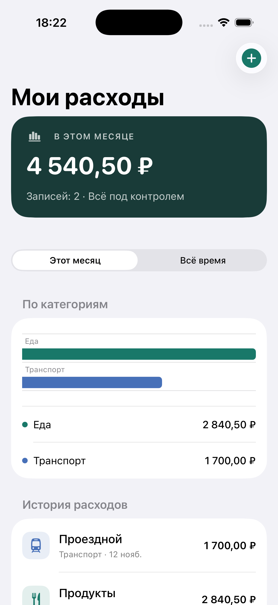

# Expense Notes

Небольшое iOS-приложение для учёта личных расходов: записывайте покупки, смотрите общую сумму и распределение по категориям. SwiftUI, Swift Charts и локальное хранение без сервера, регистрации и сторонних библиотек.



## Возможности

- Добавление покупки: название, сумма в рублях, категория и дата.
- Шесть категорий: еда, транспорт, дом, досуг, здоровье и другое.
- Итог и горизонтальная диаграмма за текущий календарный месяц либо за всё время.
- История с самыми свежими записями сверху; удаление свайпом влево.
- Сохранение в JSON между запусками. Работа полностью офлайн.
- Пустое состояние, понятная валидация и сообщения об ошибках чтения/записи.
- Системные светлая/тёмная темы, подписи VoiceOver, адаптивный список для iPhone и iPad.

## Запуск

Требуются macOS с Xcode 16 или новее (Swift 6) и iOS 17 или новее. Сборки проверены в Xcode 26.6 с iOS SDK 26.5.

1. Откройте `ExpenseNotes.xcodeproj`.
2. Выберите схему **ExpenseNotes** и установленный iPhone Simulator.
3. Нажмите **Run**. Для физического iPhone дополнительно выберите свою команду в **Signing & Capabilities** и при необходимости уникальный Bundle Identifier.
4. Нажмите плюс справа вверху, введите название, сумму и сохраните запись.

Никаких ключей API или дополнительных зависимостей не требуется.

### Демонстрационные данные

Для скриншота можно включить аргумент `--demo` в **Product → Scheme → Edit Scheme → Run → Arguments**. Он действует только в Debug: показывает пять примеров, маркирует экран «ДЕМО» и не читает/не изменяет личные записи. После удаления аргумента приложение снова работает с обычным хранилищем. При обычном первом запуске список пустой.

## Как устроено

| Файл | Ответственность |
| --- | --- |
| `Expense.swift` | Модель расхода, категории, точный разбор суммы, форматирование и агрегация |
| `ExpenseRepository.swift` | Версионированный JSON, проверка загружаемых данных и атомарная запись |
| `ExpenseView.swift` | Главный экран, форма ввода и `ExpenseStore`, управляющий состоянием |
| `ExpenseNotesApp.swift` | Точка входа SwiftUI |
| `Tests/ExpenseCoreTests/ExpenseCoreTests.swift` | Независимые от симулятора тесты ядра |

Денежные значения — целые копейки `Int64`. Строка `123,45` или `123.45` превращается в `12_345` без промежуточного `Double`; значения с третьим знаком не округляются молча, а отклоняются. Только для геометрии диаграммы используется `Double`, подписи и итог остаются точными.

Одна запись ограничена суммой 10 000 000 ₽, список — 10 000 записями. Это задаёт безопасную верхнюю границу суммы и объёма локального файла. Файл находится внутри контейнера приложения: `Application Support/ExpenseNotes/expenses.json`. Сначала выполняется атомарное сохранение, затем обновляется экран. При ошибке записи прежнее состояние остаётся доступным. При повреждении файла приложение не заменяет его пустыми данными и блокирует новые изменения до успешного чтения.

Фильтр месяца использует календарь и часовой пояс устройства. Диаграмма и история всегда используют один и тот же набор отфильтрованных расходов.

## Проверки

Автоматические проверки повторены 11 ноября 2026 года:

- **11 автоматических XCTest-тестов прошли, 0 ошибок.** Проверены точные копейки, точка/запятая, минимальная и максимальная суммы, недопустимый ввод, валидация названия, итог по категориям, максимальный размер списка, сохранение и повторное чтение, удаление, повреждённый JSON, неизвестная версия файла, неверные деньги в загруженном файле, повторяющиеся идентификаторы и ошибка записи.
- **Полная Debug-сборка для iOS Simulator успешна 11 ноября**, arm64 и x86_64.
- **Полная Release-сборка для iOS-устройства успешна 9 ноября**, без подписи. Это проверка сборки, а не установка на физический iPhone.
- **Ручная проверка 12 ноября на iPhone 17 Pro / iOS 26.2:** добавлены тестовые расходы «Продукты» 2840,50 ₽ и «Проездной» 1700.00 ₽; итог 4540,50 ₽ и категории верны. Удаление проездного уменьшило итог до 2840,50 ₽. После остановки и повторного запуска оставшаяся запись и удаление сохранились. Скриншот снят с работающего приложения до удаления записи.
- Тесты ядра не покрывают SwiftUI-экран, `ExpenseStore` и выбор календарного месяца; эти сценарии проверяются отдельно через интерфейс.

Тесты ядра запускаются из корня репозитория:

```sh
swift test
```

Тесты собраны отдельным Swift Package и выполняются на Mac: iOS Simulator для них не требуется. Схема приложения в Xcode не содержит отдельный iOS test target.

Команда проверки приложения:

```sh
xcodebuild -project ExpenseNotes.xcodeproj -scheme ExpenseNotes \
  -configuration Debug -sdk iphonesimulator \
  -destination 'generic/platform=iOS Simulator' \
  -derivedDataPath /tmp/ExpenseNotesDerivedData \
  CODE_SIGNING_ALLOWED=NO build
```

## Границы проекта

Это pet-проект, а не банковский сервис. В нём нет подключения к банкам, облачной синхронизации, бюджетов, доходов, нескольких валют, экспорта, редактирования и восстановления удалённых записей. Для исправления записи её нужно удалить и добавить заново. Удаление самого приложения удаляет локальную базу. Не добавлены собственная иконка приложения и автоматические UI-тесты; проект пока не готовился к публикации в App Store.

JSON небольшого ограниченного объёма сохраняется синхронно. Для большой базы логичнее перейти на SwiftData/Core Data, вынести операции хранения с главного потока и добавить миграции. Обработка повреждённого файла сейчас сохраняет исходный файл, но не предлагает встроенный интерфейс восстановления.
